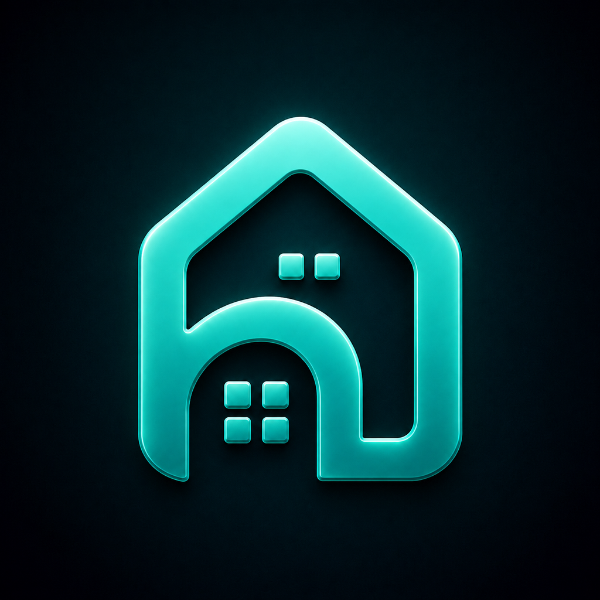

<p align="center">
  
</p>

# Homika

Homika is a local-first Android app for homestay and short-stay property owners. Keep bookings from WhatsApp, booking platforms and direct enquiries in one calendar, and track the money for each stay.

[Download the latest APK](https://github.com/nudroid12/Homika/releases/latest)

## Free and Pro

| Free | Pro |
| --- | --- |
| Manage properties, bookings, blocked dates and upcoming stays | Sync records across devices |
| Record payments, deposits and expenses | Back up automatically to Homika Cloud and restore from a cloud backup |
| Review occupancy, revenue and net income | |
| Create and restore local backup files | |

Daily work can be done offline without an account. Homika is available in English and Bahasa Melayu.

## Get started

1. Open the latest release on your Android phone and download the APK under **Assets**.
2. Install Homika on Android 8.0 or later.
3. Add your first property, then record a booking or block dates in the calendar.

Check for newer versions from **More → About → Check for updates**.

## Development

The Android app uses Kotlin, Jetpack Compose, Material 3 and Room. Use JDK 17 and Android SDK 36 to build from the repository root.

```bash
./gradlew :app:assembleDebug
```

The [Cloudflare backend](backend/README.md) handles licensing and Homika Cloud. The [store](store/README.md) handles Pro checkout.

Developed by **NudroidLabs**. [Report an issue](https://github.com/nudroid12/Homika/issues).
